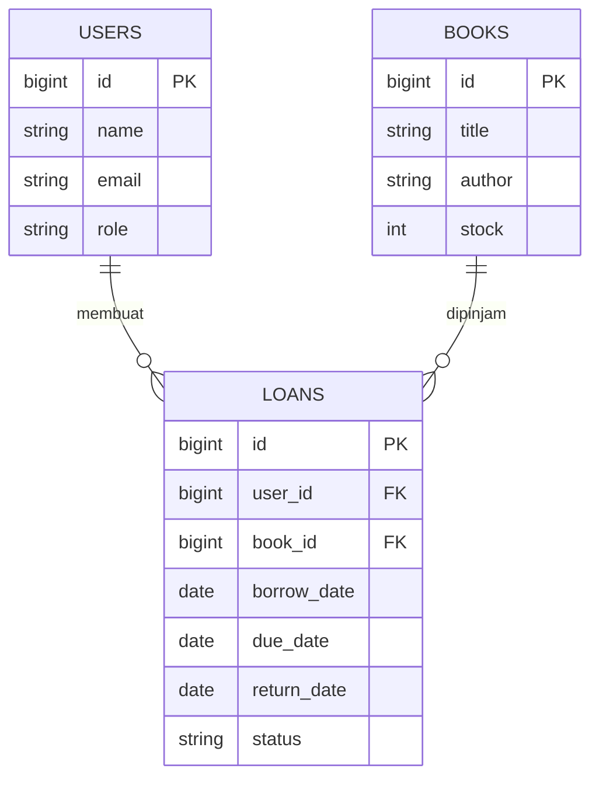

# Dokumentasi Singkat PerpusKita

## 1. Deskripsi Program
PerpusKita adalah aplikasi perpustakaan sekolah berbasis web untuk membantu admin mendata koleksi dan anggota, serta membantu siswa mencari, meminjam, dan mengembalikan buku. Aplikasi dirancang untuk dijalankan di localhost dengan database MySQL XAMPP.

## 2. Aktor dan Hak Akses
- Admin: login, dashboard, CRUD buku, CRUD anggota, melihat transaksi, mencatat pengembalian.
- Siswa: daftar akun, login, melihat dan mencari buku, meminjam buku, mengembalikan buku miliknya.

## 3. ERD (ringkasan relasi)
- users (1) —— (N) loans
- books (1) —— (N) loans
- Satu user dapat mempunyai banyak transaksi.
- Satu buku dapat tercatat pada banyak transaksi sepanjang waktu.

## 4. Fungsi/Prosedur
- AuthController: menampilkan form login/daftar, memvalidasi kredensial, membuat akun siswa, dan logout.
- BookController: menampilkan dan mencari buku; admin dapat menambah, mengubah, dan menghapus buku.
- MemberController: admin mengelola data anggota siswa.
- LoanController: mencatat peminjaman, memeriksa stok, mengurangi stok, mencatat pengembalian, dan menambah stok kembali.
- AdminMiddleware: membatasi halaman pengelolaan agar hanya dapat diakses admin.

## 5. Aturan Bisnis
- Stok tidak boleh kurang dari nol.
- Peminjaman hanya dapat dilakukan jika stok tersedia.
- Peminjaman mengurangi stok satu.
- Pengembalian mengubah status menjadi `dikembalikan`, mencatat tanggal, dan menambah stok satu.
- Siswa hanya dapat mengembalikan transaksi miliknya.
- Buku yang sedang dipinjam tidak dapat dihapus.

## 6. Pengujian / Debugging
Checklist pengujian manual:
1. Login dengan akun admin demo.
2. Tambah, edit, cari, dan hapus satu buku uji.
3. Tambah anggota dan edit data anggota.
4. Login dengan akun siswa demo.
5. Cari buku dan lakukan peminjaman saat stok tersedia.
6. Pastikan stok turun satu.
7. Kembalikan buku dan pastikan stok naik satu.
8. Coba akses URL admin dengan akun siswa; sistem seharusnya menolak dengan HTTP 403.
9. Coba pinjam buku dengan stok nol; sistem seharusnya menolak.
10. Cek tampilan di layar laptop dan ponsel.

Catat hasil aktual pada lembar evaluasi setelah pengujian dilakukan. Jangan menulis pengujian berhasil sebelum benar-benar dicoba di komputer.

## 7. Evaluasi Singkat
Aplikasi memenuhi alur dasar pendataan buku, anggota, dan transaksi peminjaman/pengembalian. Pengembangan berikutnya dapat mencakup persetujuan peminjaman oleh admin, notifikasi keterlambatan, cetak laporan, dan denda keterlambatan.
